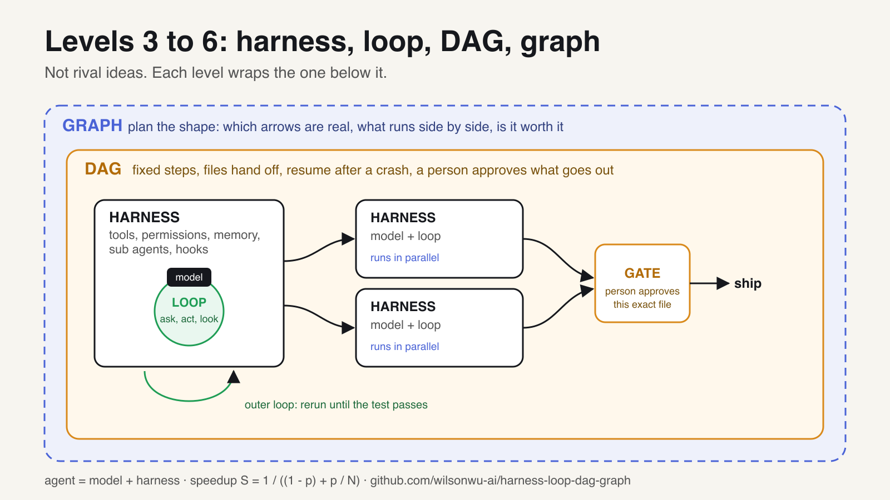

# Prompt → Context → Harness → Loop → DAG → Graph

**The six levels of building with AI, and the one question each level answers.** Levels 3 to 6 come with runnable code: 151 lines of Python, 19 tests, no API key.



Most people using AI are still on level 1. They type a sentence, read the answer, and type a better sentence. When it fails they wait for a better model.

The sentence stopped being the bottleneck a while ago. Each level up hands the model something bigger to work with:

| Level | You hand the model | The question it answers |
|---|---|---|
| 1 Prompt | a sentence | What should I say? |
| 2 Context | a window | What does it need to see? |
| 3 Harness | an environment | What turns its words into work? |
| 4 Loop | a schedule | How does it keep going without me? |
| 5 DAG | a fixed route | What are the steps, and who approves what ships? |
| 6 Graph | the shape of the job | What can run at the same time, and is it worth it? |

Each level wraps the one below it. New models arrive every few weeks; the levels do not move.

```
git clone https://github.com/wilsonwu-ai/harness-loop-dag-graph && cd harness-loop-dag-graph
python3 -m unittest discover -s tests     # 19 tests, standard library only
```

Every example uses `examples/fake_model.py`, a scripted stand in for an LLM, so each run gives the same answer. Swap in a real model call when you want.

---

## 1. Prompt: you are the loop

You write, it answers, you judge, you rewrite. It works, and it is the slowest way to use AI, because every retry waits on you.

**Where it breaks:** no sentence can give the model a fact it does not have, a tool it cannot call, or a way to check its work.

**Move up:** next time an answer is wrong, do not rewrite the instruction. Ask what the model needed to *see*. If the answer is a file, a rule or an example, the problem was context.

## 2. Context: fill the window, not the sentence

Tobi Lütke called it the art of giving the model all the context needed for the task to be "plausibly solvable" (June 2025), and Andrej Karpathy backed the term. The model knows only what is in its window at this step.

Budget the window: rules that never change (a project file like CLAUDE.md), tools described clearly enough to choose between, memory of earlier decisions, the 3 files that matter instead of the 300 that exist, and the task last.

**Where it breaks:** it is still one call at a time, assembled by you. The moment you want the model to act, run code, check a result and try again, something has to do that for it.

## 3. Harness: the model is the engine, the harness is the car

`agent = model + harness`. The harness is everything around the model: the loop that feeds tool results back, the tools, permissions, memory, sub agents and hooks. Put the same model in two harnesses and you get two different agents.

* A [source study of 11 production coding agents](https://arxiv.org/abs/2609.00006) (about 4 million lines) found the same 7 subsystems in all of them, no agent framework in any of them, and no vector search over code.
* A [Fudan and Peking University paper](https://arxiv.org/abs/2604.25850) let an agent keep editing another agent's harness. Over ten rounds Terminal-Bench 2 went from 69.7% to 77.0%, past the human designed Codex CLI harness at 71.9%.

**Code:** `examples/harness.py` has a tiny version of all 7 parts. Tests prove a denied tool is blocked, an "ask" tool waits for approval, an unknown tool is denied by default, old context is compacted, and a sub agent gets its own context.

**The first move you can make today:** a gate the agent cannot talk its way past. In Claude Code a Stop hook runs whenever the agent tries to finish; exit code 2 blocks the stop and sends the error back. `examples/stop_hook.json`:

```json
{"hooks": {"Stop": [{"hooks": [{"type": "command", "command": "python3 -m unittest discover -s tests >&2 || exit 2"}]}]}}
```

Now "done" means the tests pass.

**Where it breaks:** even a perfect harness waits for a human to type the task.

## 4. Loop: stop being the one who prompts

Addy Osmani named it in [Loop Engineering](https://addyosmani.com/blog/loop-engineering/) (7 June 2026): design loops that prompt your agents instead of prompting them yourself. It goes back to Geoffrey Huntley's [Ralph](https://ghuntley.com/ralph/) (July 2025): "In its purest form, Ralph is a Bash loop."

There are two loops. The **agent loop** inside the harness: ask, act, look, repeat. The **outer loop**: rerun a whole fresh attempt until something that cannot argue back, a test, says it passed. Progress lives in files, so every attempt starts clean.

**Code:** `examples/loop.py`. Tests prove the agent loop runs a tool then answers, it stops at a turn limit, and the outer loop retries until the check passes.

**Brakes every loop needs:** a done check outside the model, a budget (runs, tokens, dollars), a stop after rounds that find nothing new, and state written after every step.

**Where it breaks:** a loop is one track. A job with 40 files to review just takes 40 times as long, and a job that ships something needs a person to approve it.

## 5. DAG: fix the route and put a person on the exit

A DAG is a set of steps decided before the run, each naming the files it reads and writes. It is the oldest idea here: data pipelines have run this way for years, and Anthropic's [Building effective agents](https://www.anthropic.com/research/building-effective-agents) (Dec 2024) calls these workflows, "predefined code paths", as opposed to agents. "DAG engineering" is not an established term; the idea is.

What it buys you: a crash resumes instead of restarting, and anything irreversible (send, publish, pay, delete) waits at a gate where a person approves *exactly* what will go out.

**Code:** `examples/dag.py`. Tests prove steps run in dependency order, a second run skips finished steps, and an approval stops counting the moment the approved file changes.

**Where it breaks:** a fixed route is still a line. Steps that never read each other's output still wait in it.

## 6. Graph: draw the shape of the job

A node is one bounded job with a clear input and output. An arrow exists only where one node's output feeds the next. Most "step 1, then 2, then 3" plans are full of fake arrows. Delete them and the line becomes a diamond: **split, fan out, verify, merge.**

Two rules keep it honest:

* **Hidden arrows are real.** Two steps that write the same file must not run at once, even if neither reads the other.
* **Do the math before you pay for agents.** If a share `p` of the work can run in parallel on `N` agents:

```
S = 1 / ((1 - p) + p / N)        ceiling: 1 / (1 - p)
```

16 agents at p = 0.95 buys about 9.1x, not 16x. At p = 0.6 nothing beats 2.5x.

**Code:** `examples/graph.py`. Tests prove fake arrows are removed, two writers of one file are kept apart, the math matches Amdahl's law, and a layer really runs in parallel.

---

## Which level are you on? The 30 second test

* You rewrite the same instruction until it works: **1**.
* You load the project file and the right docs before every task: **2**.
* Your agent runs tools and cannot call itself done until a check passes: **3**.
* Work starts without you typing anything: **4**.
* Anything that ships stops at a gate with your name on it: **5**.
* One request fans out to many agents, gets verified, and merges back: **6**.

## Six things to build this week

1. **Prompt:** delete every "you are an expert" line from your favorite prompt and add one example of a great answer.
2. **Context:** write a one page project file and load it before every session.
3. **Harness:** add the Stop hook above.
4. **Loop:** put one task on a schedule with a budget and a state file.
5. **DAG:** put one approval gate in front of something you send.
6. **Graph:** split one review across files, fan it out, have a skeptic attack every finding, merge the survivors.

## What the big harness study found

[Harness Engineering: Anatomy, Architecture, and Evolution of Coding Agents](https://arxiv.org/abs/2609.00006) (Barbaste, Darrigol, Vu, Wiltberger; 15 July 2026; CC BY 4.0) read the source of Claude Code, Codex CLI, Gemini CLI, Mistral Vibe, OpenHands, Aider, Mini SWE Agent, Hermes, Pi, OpenCode and OpenClaw.

* 7 subsystems in every one: agent loop, LLM integration, tools and actions, memory and context, safety and permissions, orchestration, extensibility.
* Across roughly 4 million lines, no agent runtime imports a general purpose agent framework.
* No vector search over code: ripgrep, tree-sitter, glob and Markdown context files.
* SKILL.md skills in 9 of 11, MCP in 8 of 11.
* 29 recurring design patterns and 18 recommendations. A viral summary called the 18 "patterns"; they are recommendations. The first one is to start with a plain while loop.

## Go deeper

* [Graph Engineering for Operators](https://github.com/wilsonwu-ai/graph-engineering-for-operators): my long write up of level 6.
* [claude-graph-skills](https://github.com/wilsonwu-ai/claude-graph-skills): Claude Code skills for levels 5 and 6 (`/graph` plans a fan out, `/dag` binds approvals to a digest).

## Credits

The ladder format follows a [popular post](https://x.com/L1vsun/status/2116519560631205914) on the five levels of AI engineering; this repo adds the DAG level and runnable code. Sources are linked where they are used. Code here is original and MIT licensed.
